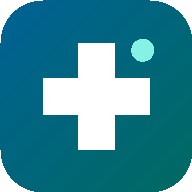

<div align="center">



# 💊 جعبه داروی من (Jabe Daru)

**مدیریت هوشمند، رایگان و ۱۰۰٪ آفلاین داروهای خانگی و کمک‌های اولیه**

[](https://sayyedali-hoseini.github.io/jabe-daru/)
[](./LICENSE)
[](#)

[🚀 **ورود مستقیم به اپلیکیشن و نصب روی گوشی**](https://sayyedali-hoseini.github.io/jabe-daru/)

</div>

---

<div dir="rtl">

## 🎯 چرا «جعبه داروی من» ساخته شد؟

تا حالا چند بار پیش آمده که در **مطب دکتر** یا **داروخانه** بایستید و دقیقاً یادتان نیاید کدام قرص‌ها، شربت‌ها، پمادها یا حتی ورق‌های نصفه‌ای که از قبل داشته‌اید در خانه موجود است؟ نتیجه معمولاً **پرداخت هزینه تکراری برای دارو** و **انباشته‌شدن داروهای تاریخ‌گذشته** در خانه است.

**«جعبه داروی من»** یک وب‌اپلیکیشن سبک، رایگان و متن‌باز است که برای کمک به خانواده‌ها طراحی شده تا:
- بدون نیاز به ساخت حساب کاربری، ثبت‌نام یا دانلود از مارکت‌ها، همیشه فهرست داروهای خانه را در جیب خود داشته باشند.
- با یک لمس روی گوشی نصب شود و در داروخانه‌هایی که آنتن ضعیف است، **کاملاً بدون اینترنت** کار کند.
- با شفافیت کامل، هیچ داده‌ای را به هیچ سروری نفرستد.

---

## ✨ امکانات کلیدی

- **🔒 ۱۰۰٪ آفلاین و خصوصی:** تمام اطلاعات فقط در حافظه دستگاه خودتان (`localStorage`) ذخیره می‌شود؛ بدون سرور، بدون تبلیغات و بدون ردیابی.
- **📚 بانک داخلی ۱۲۰+ داروی رایج ایران:** ثبت سریع داروهای پرمصرف، مسکن‌ها، شربت‌ها، پمادها، سرنگ و لوازم کمک‌های اولیه با جستجوی آنی و پیشنهاد خودکار هنگام تایپ.
- **🧠 یادگیری داروهای شخصی:** هر داروی خاص یا کمیابی را که دستی ثبت کنید، به صورت خودکار در بانک داروی شخصی خودتان ذخیره می‌شود تا برای دفعات بعدی همیشه آماده باشد.
- **📦 پک‌های آماده شروع:** امکان افزودن سریع پک‌های عمومی خانه، کودک و کمک‌های اولیه با یک کلیک.
- **🔍 حالت «تو داروخونه‌ای؟» + جستجوی صوتی فارسی:** با تایپ یا گفتن نام دارو (`Web Speech API`)، درجا به شما می‌گوید این دارو را سالم در خانه دارید، منقضی/تمام شده، یا در خانه نیست.
- **🌗 نشانگر ورق نصفه و شربت درب‌باز:** مشخص‌کردن داروهای بازشده برای اولویت در مصرف و جلوگیری از دورریز.
- **📅 تقویم واقعی شمسی و میلادی:** ثبت اختیاری تاریخ انقضا با هر دو تقویم و هشدار خودکار پیش از انقضا.
- **🩺 حالت مطب دکتر:** نمایش تمیز و دسته‌بندی‌شده فقط داروهای سالم و موجود در خانه با قابلیت بزرگ‌نمایی متن (`A+` / `A-`) برای رویت سریع پزشک.
- **👓 حالت ساده (پدر و مادری) و حالت شب:** فونت درشت و دکمه‌های بزرگ برای استفاده راحت‌تر سالمندان و افراد غیرفنی.
- **🛒 لیست خرید هوشمند:** فضایی مجزا برای یادداشت نسخه جدید یا اقلام ضروری انتخاب‌شده توسط خودتان (بدون اضافه کردن خودکار داروهای بیماری‌های قبلی).
- **👨‍👩‍👧‍👦 اشتراک‌گذاری خانوادگی بدون سرور:** ارسال مستقیم لیست با یک لینک به گوشی همسر یا والدین (با امکان ادغام یا جایگزینی)، کپی متنی مرتب برای واتساپ/ایتا/تلگرام و خروجی/بازیابی فایل `JSON`.

---

## 📱 راهنمای نصب رایگان روی گوشی (برای کاربران)

1. لینک زیر را با مرورگر گوشی باز کنید:
   👉 **[https://sayyedali-hoseini.github.io/jabe-daru/](https://sayyedali-hoseini.github.io/jabe-daru/)**
2. **در اندروید (Chrome):** گزینه **«نصب برنامه / Add to Home screen»** را بزنید.
3. **در آیفون (Safari):** دکمه **Share** (مربع و فلش رو به بالا) را بزنید و **Add to Home Screen** را انتخاب کنید.

از این پس آیکون برنامه روی صفحه گوشی شما قرار می‌گیرد و **بدون نیاز به اینترنت** اجرا می‌شود.

---

## 🤝 مشارکت در توسعه (Open Source)

این پروژه با عشق و برای کمک به خانواده‌ها به صورت متن‌باز منتشر شده است. خوشحال می‌شویم اگر:
- نام داروی پرکاربردی را که در لیست نیست در بخش **Issues** پیشنهاد دهید یا به فایل `src/data/drugCatalog.ts` اضافه کنید (Pull Request).
- با ستاره‌دادن (⭐ Star) به این مخزن و معرفی آن به دوستان و خانواده، به بیشتر دیده‌شدنش کمک کنید.

</div>

---

## 🛠 English Technical Summary

**Jabe Daru (جعبه داروی من)** is a 100% client-side, offline-first Persian (`dir="rtl"`) Progressive Web App designed for household medicine inventory tracking, clinic visits, and pharmacy checks.

### Tech Stack
- **Frontend:** React 19 + TypeScript
- **Styling:** Tailwind CSS v4 (compiled locally, zero external CDNs)
- **Typography & Icons:** Self-hosted `@fontsource/vazirmatn` + `lucide-react`
- **Offline & PWA:** `vite-plugin-pwa` (Workbox precaching)
- **Serverless Sharing:** `lz-string` URL-hash state compression + JSON backup/restore

### Local Development
```bash
git clone https://github.com/sayyedali-hoseini/jabe-daru.git
cd jabe-daru
npm install
npm run dev
npm run build
```

<div align="center">
Released under the MIT License · Made to reduce household medicine waste & duplicate spending 💚
</div>
